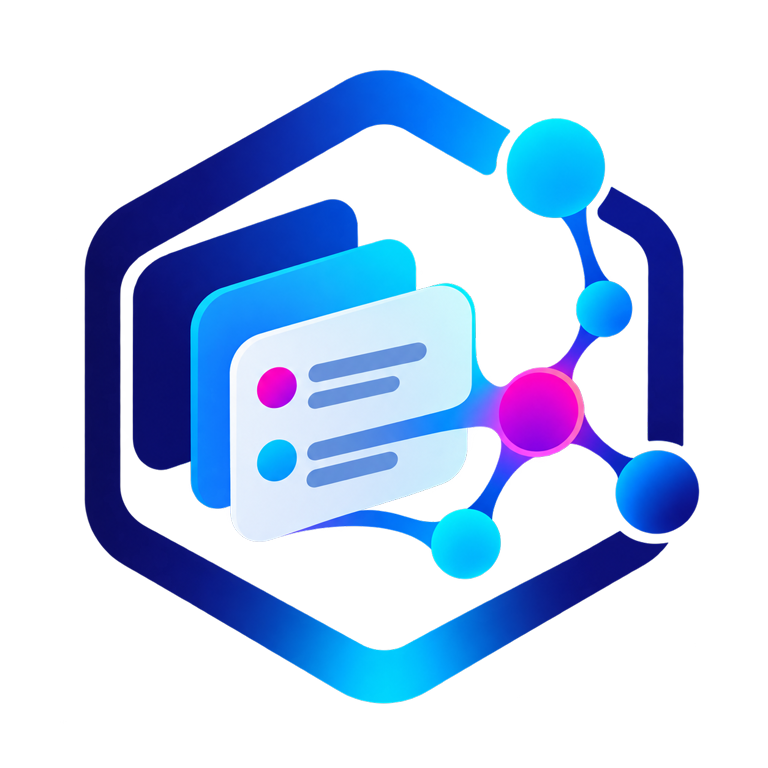
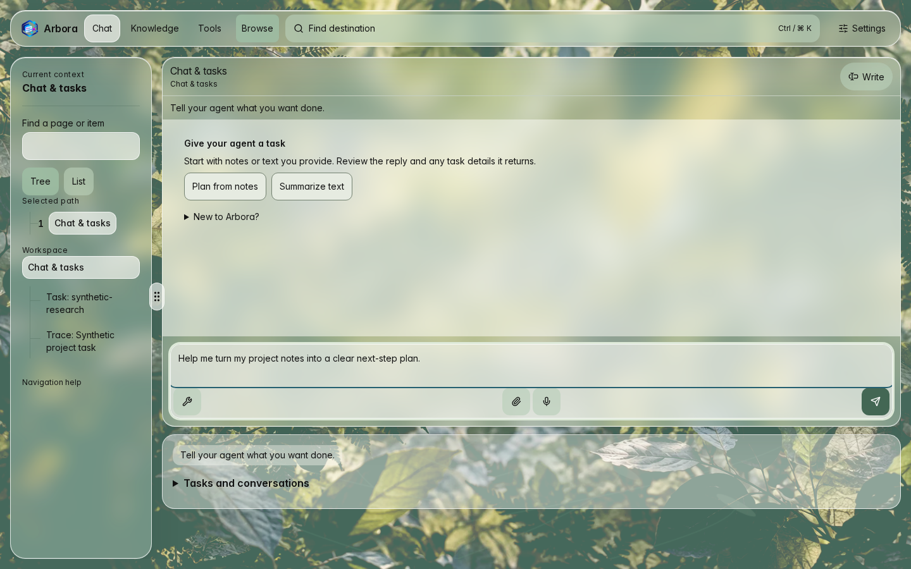

# Overstory

<p align="center">
  
</p>

Overstory is the browser workspace for Arbora. The repository is `overstory`;
the package remains `agent-webui`. Existing gallery images retain their original capture provenance.

<p align="center">
  <strong>The browser workspace for governed agents, workflows, and knowledge in Arbora.</strong><br>
  <sub>Conversations · approvals · workflows · fleet activity · Understory knowledge views</sub>
</p>

<p align="center">

[](https://pypi.org/project/agent-webui/)
[](https://github.com/Knuckles-Team/overstory/actions/workflows/release.yml)
[](https://knuckles-team.github.io/overstory/)
[](LICENSE)
[](https://github.com/Knuckles-Team/overstory/actions/workflows/pages.yml)
[](https://pypi.org/project/agent-webui/)
[](https://pypi.org/project/agent-webui/)
[](https://pypi.org/project/agent-webui/)
[](https://pypi.org/project/agent-webui/)
[](https://github.com/Knuckles-Team/overstory/stargazers)
[](https://github.com/Knuckles-Team/overstory/forks)
[](https://github.com/Knuckles-Team/overstory/graphs/contributors)
[](https://github.com/Knuckles-Team/overstory/commits/main)
[](https://github.com/Knuckles-Team/overstory/pulls)
[](https://github.com/Knuckles-Team/overstory/pulls?q=is%3Apr+is%3Aclosed)
[](https://github.com/Knuckles-Team/overstory/issues)
[](https://github.com/Knuckles-Team/overstory)
[](https://github.com/Knuckles-Team/overstory)
[](https://github.com/Knuckles-Team/overstory)
[](https://github.com/Knuckles-Team/overstory)

</p>

<p align="center">
  <a href="https://knuckles-team.github.io/overstory/">Documentation</a> ·
  <a href="https://knuckles-team.github.io/overstory/features/">Capabilities</a> ·
  <a href="https://knuckles-team.github.io/overstory/architecture/">Interfaces</a> ·
  <a href="https://knuckles-team.github.io/overstory/status/">Status</a>
</p>



The conversation-first workspace uses synthetic demo data, not a live account.
Open **Settings** for theme, surface and privacy choices.
See the [workspace gallery and screenshot refresh guide](docs/screenshots.md).

## Overview

Overstory is the browser workspace composed by Arbora. It brings agent
conversations, approvals, workflows, fleet activity, and Medulla
exploration into one React application. Its FastAPI host keeps privileged
credentials and gateway delegation on the server side.

| Overstory owns | Other components own |
|---|---|
| Browser presentation, local interaction state, accessible route composition, and the FastAPI boundary | Arbora owns public routing, identity, policy, and fleet supervision; Meristem applies supplied plans; Medulla owns durable knowledge; connector services own external-system effects |

Current package Version: 2.8.3.

## Key capabilities

- Stream agent responses with sources, governed tool activity, and approval prompts.
- Build and run workflows while observing sessions, goals, schedules, and fleet health.
- Explore property graphs, RDF, schemas, objects, tables, documents, code, and memories through Understory and Medulla.
- Discover MCP Apps and connector capabilities without exposing service credentials to the browser.
- Apply one role-aware navigation and server authorization model across the complete workspace.
- Run as the Arbora-hosted browser co-service or as an independently deployed ASGI application.

## Documentation

Start with the [Overstory documentation](https://knuckles-team.github.io/overstory/),
then use the shared platform map to move between components:

| Component | Role | Documentation |
|---|---|---|
| Overstory | Browser operator workspace and Understory knowledge views | [Docs](https://knuckles-team.github.io/overstory/) |
| Tuig | Terminal and headless client; central A2A/REST and experimental headless local ACP; full session parity remains unqualified | [Docs](https://knuckles-team.github.io/tuig/) |
| Axil | Desktop cockpit for chat, graph, fleet, health, and operator workflows | [Docs](https://knuckles-team.github.io/axil/) |
| Arbora messaging | Chat and voice entrypoints hosted by Arbora | [Docs](https://knuckles-team.github.io/arbora/) |
| Arbora | Public MCP, REST, A2A, identity, policy, and runtime composition | [Docs](https://knuckles-team.github.io/arbora/) |
| Meristem | In-run harness that applies supplied plans | [Docs](https://knuckles-team.github.io/meristem/) |
| Medulla | Durable multimodal data, reasoning, provenance, and transactions | [Docs](https://knuckles-team.github.io/medulla/) |
| Scion SDK | Typed source adapters, connector serving, and write-back contracts | [Docs](https://knuckles-team.github.io/scion-sdk/) |

## Architecture

[](https://knuckles-team.github.io/.github/architecture/#webui)

[Explore the live architecture](https://knuckles-team.github.io/.github/architecture/#webui)

People also enter through Tuig and Axil or Arbora-hosted
messaging. Tuig retains central A2A/REST and experimental headless local ACP;
full session parity remains unqualified. External applications connect over MCP,
REST, or A2A. The browser talks only to its same-origin FastAPI host. Arbora injects gateway routes and
verified request context. Meristem applies supplied plans; Medulla owns
durable knowledge. Source systems connect through Scion SDK
directly to Medulla. Overstory renders typed results
and local presentation state while each service retains its own authority.

See the [architecture guide](https://knuckles-team.github.io/overstory/architecture/)
for the request flow and trust boundaries.

## Quick start

Generate a local profile and start Arbora with Overstory enabled:

```bash
uvx --from "arbora[webui]" setup-config generate --profile tiny
export ENABLE_WEB_UI=true
uvx --from "arbora[webui]" arbora --transport streamable-http --host 127.0.0.1 --port 8000
```

Open <http://127.0.0.1:8080>. Arbora serves MCP on port `8000` and the Agent
Web UI co-service on port `8080`. The [start guide](https://knuckles-team.github.io/overstory/start/)
covers local source development and deployment profiles.

## Contributing

Issues and pull requests are welcome. Read [AGENTS.md](AGENTS.md), keep browser
and server authority boundaries intact, and run the repository validation suite
before opening a pull request.

Refresh the documented workspace views with `pnpm screenshots:refresh`. See the
[screenshot guide](docs/screenshots.md) for synthetic fixtures, hosted capture,
provenance and review before committing refreshed images.

## License

Overstory is available under the [MIT License](LICENSE).
