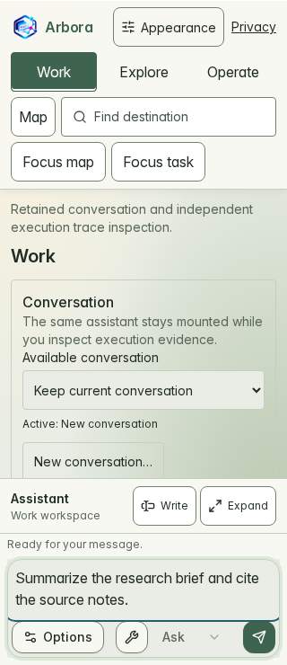
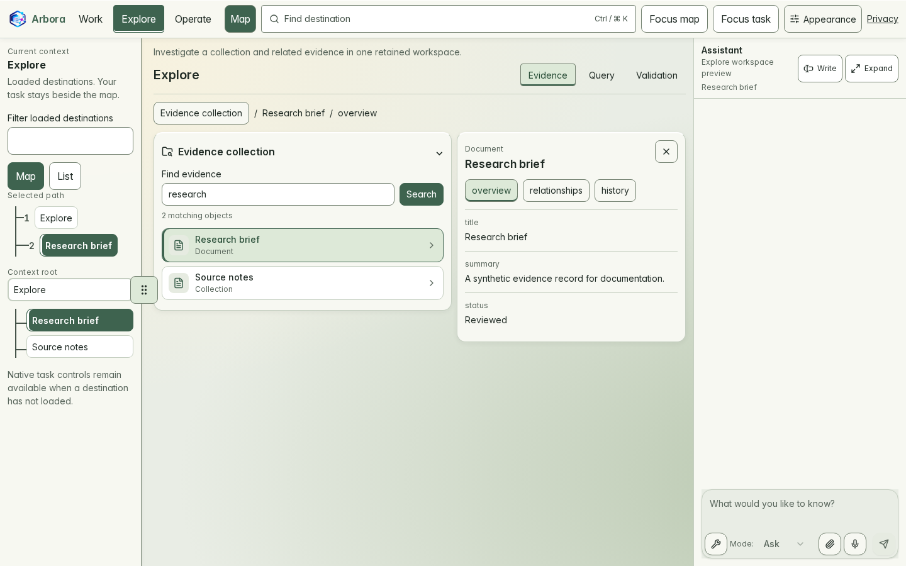
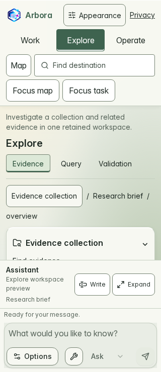
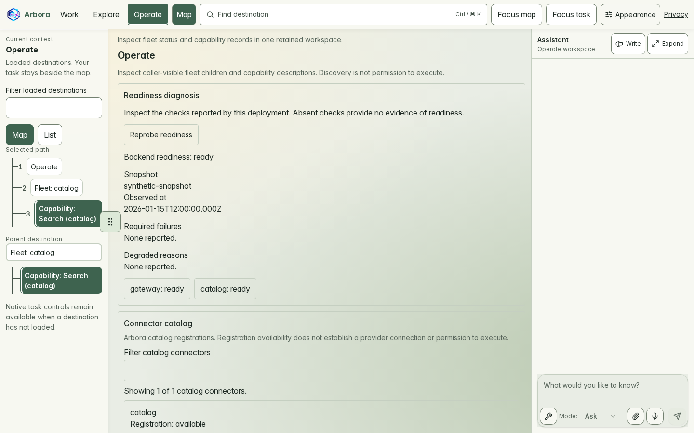
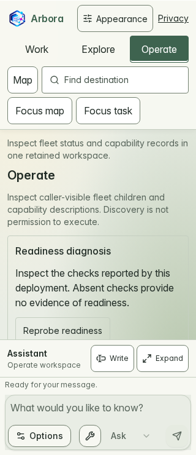

# Refresh workspace screenshots

Capture the real React workspace with fixed synthetic responses. No account,
provider, production backend, or stored browser session is used. These images
illustrate the interface, not live service availability or complete feature acceptance.

## Workspace gallery

These are real browser captures of Canopy light and the persistent assistant,
with synthetic demo data, not live accounts.
Each pair shows the initial viewport at 1440 × 900 and 320 × 740 pixels.
On wide screens, the assistant sits beside the task; on narrow screens, it docks
below the task. Scrollable task panels continue below the visible area. The
readiness and completion labels describe the fixture, not a live deployment.

Open **Appearance** in the workspace header to choose **Canopy light** or
**Canopy dark** under **Theme**, or follow the system preference. **Surfaces**
selects **Glass framing** or **Opaque framing** independently of the palette.
Reading surfaces remain solid. See the [design system](design-system.md) for
the source tokens and accessibility limits.

### Work

An empty conversation contains an unsent draft, not a completed live chat.




### Explore





### Operate





### Capture provenance

This gallery uses the complete `documentation-screenshots` artifact.

- Source run: [CI 40144867369](https://github.com/Knuckles-Team/agent-webui/actions/runs/40144867369).
- Rendered source: `d615e1c629fc8bb1fad05cbfd5246b38f984ff42` (clean tree).
- Browser: Chromium 156.0.8078.4 on Linux.

This source includes Canopy and the native assistant.
Its frontend, public assets and capture inputs match main revision
`546a4bc04f58bebcbcf91281ac8a570666c315bb` used for this refresh.
The [manifest](assets/screenshots/manifest.json) preserves each original source revision and image digest.
The importer copies the original PNGs without repainting or substituting scenes.

## Refresh locally

From the repository root, install the locked dependencies and Chromium once:

```bash
pnpm install --frozen-lockfile
pnpm exec playwright install chromium
```

Then refresh the six images and validate the result:

```bash
pnpm screenshots:refresh
pnpm screenshots:check
pnpm screenshots:test
```

The `screenshots:check` command checks saved image bytes and metadata. It does not detect
changes to the current UI. Refresh after UI changes, then review the images
before updating the README.

On Linux, use `pnpm exec playwright install --with-deps chromium` when browser
system libraries are missing. The refresh command starts its own loopback Vite
server on port 5206. Stop any process using that port first. It does not reuse a
running server, accept a live target, or run the authenticated end-to-end setup.

The set covers Work, Explore and Operate at 1440 × 900 and 320 × 740 CSS pixels.
It uses Chromium, the light theme, UTC, fixed synthetic time and reduced motion.
Each CSS pixel maps to one device pixel. The capture waits for real scene content,
local fonts and images, then two layout frames. External HTTP requests and
backend WebSockets are blocked. Unknown API requests fail the capture.

Stable assets live in `docs/assets/screenshots/`:

- `work-wide.png` and `work-narrow.png`
- `explore-wide.png` and `explore-narrow.png`
- `operate-wide.png` and `operate-narrow.png`
- `manifest.json`: source revision, dirty-tree flag, fixture version, route,
  viewport, theme, browser, platform and SHA-256 digest for each image

All six captures must pass before the command copies images into the documentation
folder. Failed runs leave the existing published images unchanged. Temporary
images and per-image records remain in `test-results/documentation-screenshots/`.
Never substitute synthetic drawings or screenshots from a personal session.

## Refresh in CI

The `workspace-browser` job runs the same capture command for pull requests
and manually dispatched CI runs. It has read-only repository permission. Download its `documentation-screenshots`
artifact from the completed Actions run. It contains the actual PNG files and
per-image provenance, even with Playwright's list reporter. Failed runs can
contain only a partial set; do not publish that set.

Review all six images at their native sizes. Check content, clipping, loading
states, contrast, and whether the README image still represents the product.
For a successful hosted run, import the extracted artifact and validate it:

```bash
pnpm screenshots:import /path/to/extracted/documentation-screenshots
pnpm screenshots:check
```

The importer validates all six PNGs and records before copying them into the
stable folder and assembling the manifest. It rejects partial or mismatched sets.
Commit the reviewed images and manifest in a normal pull request.
CI never commits or pushes image updates automatically.

The source revision can be an Actions merge commit. It identifies what was
rendered, not the later commit that adds the images. A dirty-tree flag means
local tracked edits were present. Prefer a clean source commit for publication.
Browser and operating-system font rendering can vary; repeat on the same
platform for comparable images. This command is not a pixel-diff regression gate.

To change a scene, edit `e2e/fixtures/documentation-screenshots.mjs` and the
rendered readiness assertions in `e2e/documentation-screenshots.browser.ts`.
Keep the responses synthetic, bounded and explicit. Do not add credentials,
external requests, execution operations or fallback connections to real services.
The existing viewport and identity journeys remain the broader interaction tests.
